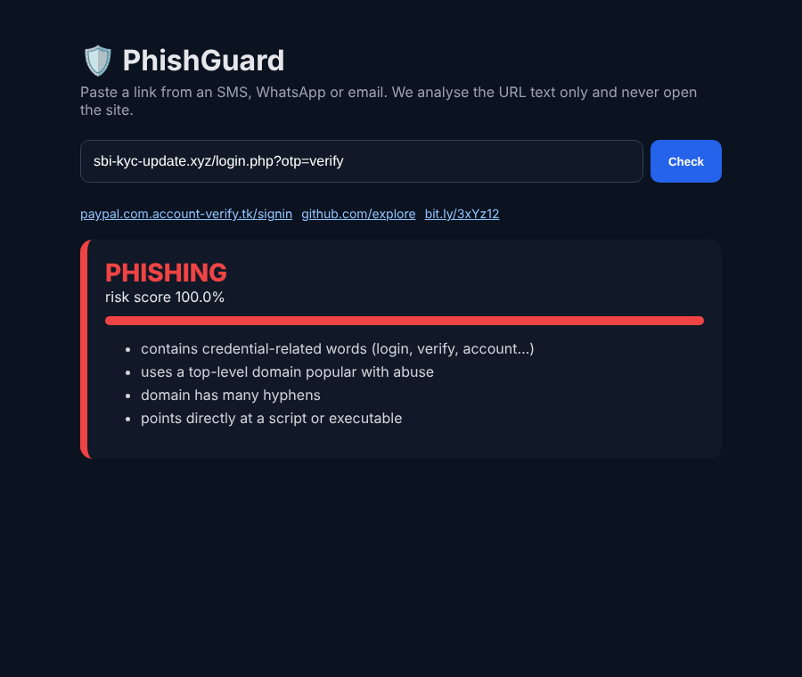
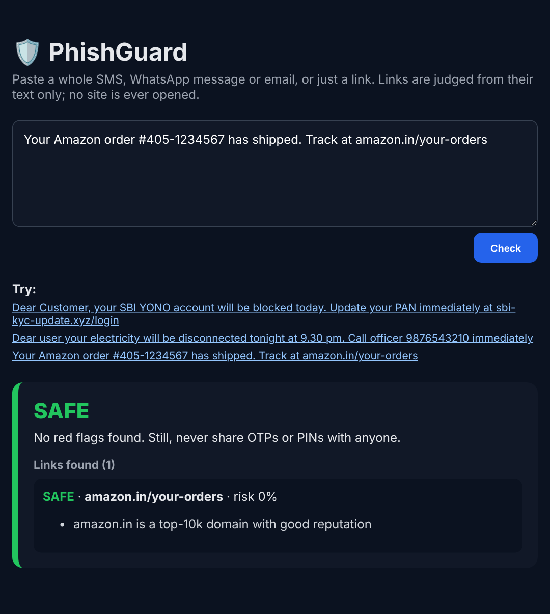

# PhishGuard: Phishing & Scam Message Detector

[](https://github.com/Drakeion2532/phishing-url-detector/actions/workflows/tests.yml)

Paste a **whole SMS, WhatsApp message or email** (or just a link) and get a verdict, the reasons in plain language, and what to do next. Links are judged from their **text alone**, so the suspicious site is never opened. The project ships as a REST API, a web checker, a command-line tool and a **Chrome extension** that warns you before you click a dangerous link.

| Scam SMS (no link, just a phone number) | Genuine delivery SMS |
|---|---|
|  |  |

## The problem

"Your SBI KYC is expiring, update now: sbi-kyc-update.xyz/login". Links like this arrive by SMS and WhatsApp every day. They spread on WhatsApp and SMS, where there's no email security gateway to filter them. People need a fast, private check that **explains why** a link is dangerous, so they learn to spot the next one themselves.

## Checking a whole message

Real users don't receive bare URLs, and many Indian scams contain **no link at all**: "your electricity will be cut tonight, call officer 98xxxxxxxx", or "share the OTP to keep your account active". So the message checker does three things:

1. **Finds every link** in the text, including bare domains such as `sbi-kyc-update.xyz/login` (how most smishing links are written), while ignoring amounts (`Rs.2,500.00`), times (`9.30 pm`) and e-mail addresses.
2. **Scores each link** with the URL model below.
3. **Looks for scam patterns in the wording**, in English and common Hinglish:
   - a request for an OTP, PIN or CVV (only a real request: "do not share your OTP" doesn't count)
   - urgency
   - threats that an account or service will be blocked
   - KYC, PAN or Aadhaar "updates"
   - prize or refund bait
   - payment requests
   - being told to call a **personal mobile number** instead of a toll-free helpline

The verdict comes with advice, including where to report the message in India: **Chakshu on [sancharsaathi.gov.in](https://sancharsaathi.gov.in)**, or the national cyber-fraud helpline **1930**.

```bash
python -m phishguard.message "Dear user your electricity will be disconnected tonight. Call officer 9876543210 immediately"
curl -X POST localhost:8003/check_message -H 'content-type: application/json' \
     -d '{"text":"Your SBI account will be blocked today. Update PAN at sbi-kyc-update.xyz/login"}'
```

The message rules are hand-written and were checked on a small set of realistic genuine and scam messages (see `tests/test_phishguard.py`), not on a labelled benchmark. A genuine message can still be flagged if it uses scam-like wording, and links on platforms where anyone can publish (Google Docs, Blogspot, URL shorteners) are deliberately rated "suspicious" rather than "safe", because phishers use them.

## How it works

```
URL ──► normalise ──┬─► 37 lexical features ──► XGBoost ───────┐
                    │   (IP host, brand-not-in-domain, risky   ├─► mean ─► reputation layer ─► verdict + reasons
                    │    TLD, free hosting, entropy, @, //…)   │          (top-10k domains,
                    └─► char 1-5-gram TF-IDF ──► LogReg ───────┘           minus shared hosting)
```

* **Lexical model.** Hand-crafted, interpretable features drive the human-readable reasons: brand name outside the real domain, credential words, punycode, IP hosts, URL shorteners, free hosting and risky TLDs.
* **Character n-gram model.** Learns obfuscation patterns such as `paypa1`, `rn` → `m` and random sub-domains.
* **Reputation layer.** URLs on top-10k domains such as `login.microsoftonline.com` are trusted. Domains where *anyone* can publish (Blogspot, Firebase, 000webhost, Pastebin, URL shorteners…) are excluded on purpose, because phishers live there.

## Results

Dataset: 119,932 URLs (60k benign, 60k malicious) from two public sources.

**20% stratified hold-out (23,987 URLs):**

| Model | Accuracy | Precision | Recall | F1 | ROC-AUC | FPR |
|---|---|---|---|---|---|---|
| XGBoost (lexical) | 93.5% | 94.5% | 92.5% | 0.935 | 0.983 | 5.4% |
| LogReg (char n-grams) | 97.3% | 98.0% | 96.5% | 0.973 | 0.996 | 2.0% |
| **Ensemble** | **97.4%** | **98.1%** | **96.6%** | **0.974** | **0.996** | **1.9%** |
| Ensemble + reputation | 97.3% | 98.3% | 96.4% | 0.973 | 0.994 | **1.7%** |

**Generalisation to a phishing feed the model never saw.** The model is trained without any Phishing.Database URLs and then tested on 10,000 of them plus held-out benign URLs:

| Model | Recall on unseen feed | Precision | FPR |
|---|---|---|---|
| XGBoost (lexical) | 83.4% | 94.6% | 3.9% |
| LogReg (char n-grams) | 82.0% | 98.2% | 1.3% |
| **Ensemble** | **87.9%** | **98.4%** | **1.2%** |

The two models make different mistakes, so the ensemble adds about 5 points of recall on new phishing campaigns. That is the scenario that matters in practice.

**Most important lexical signals:** credential words (21%), brand-not-in-domain (10%), script/executable endings (9%), TLD length and risky TLDs (17%), digits in the host (5%) and IP-address hosts (5%).

## Run it

```bash
pip install -r requirements.txt
python -m phishguard.train            # ~5 min, writes results/metrics.json + models/phishguard.joblib
python -m phishguard.eval_reputation  # effect of the reputation layer
pytest -q

uvicorn phishguard.api:app --port 8003   # web checker at http://127.0.0.1:8003
python -m phishguard.message "paste a whole SMS here"
curl -X POST localhost:8003/check -H 'content-type: application/json' \
     -d '{"url":"paypal.com.account-verify.tk/signin"}'
```

### Chrome extension

1. Start the API as above.
2. Open `chrome://extensions`, turn on **Developer mode**, click **Load unpacked** and select the `extension/` folder.
3. Clicking any external link is checked first. A phishing or suspicious link shows a warning with the reasons before you can continue.

## Data

| File | Source | Rows |
|---|---|---|
| `data/urls.csv.gz` | benign + malicious from [faizann24/Using-machine-learning-to-detect-malicious-URLs](https://github.com/faizann24/Using-machine-learning-to-detect-malicious-URLs); phishing links from [mitchellkrogza/Phishing.Database](https://github.com/mitchellkrogza/Phishing.Database) | 119,932 |
| `data/top_domains_10k.txt` | [zer0h/top-1000000-domains](https://github.com/zer0h/top-1000000-domains) | 10,000 |

URLs are normalised (scheme and `www.` stripped) before training, so the model can't cheat by learning which source writes `http://`.

## Limitations

* Lexical analysis can't see page content. A clean-looking URL on a compromised legitimate site will pass, which is why the extension says "suspicious" rather than "safe" for borderline scores.
* The benign data is older (DMOZ-era sites). Retraining with a fresh benign crawl would improve calibration.

## Structure

```
phishguard/
  features.py         37 lexical features + explanations
  message.py          link extraction + scam-wording flags for whole messages
  reputation.py       top-10k reputation layer (excludes shared hosting)
  train.py            models, hold-out + cross-source evaluation
  eval_reputation.py
  api.py              FastAPI: /check (one URL), /check_message (whole message), web UI
extension/            Chrome MV3 extension (link-click guard)
```
